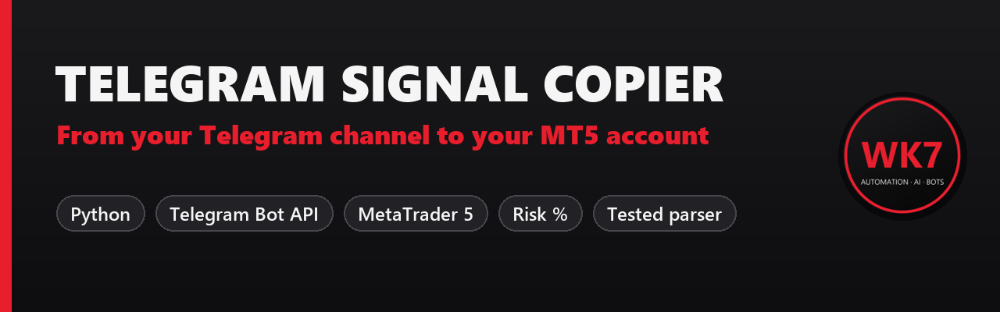
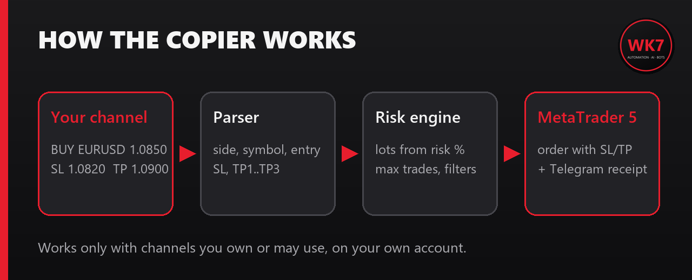

<p align="center"></p>

<p align="center">
  
  
  
  
</p>

# Telegram Signal Copier for MetaTrader 5

Reads trade signals posted in **your** Telegram channel and opens them on **your** MetaTrader 5 account
in seconds: stop loss, take profits and lot size from your risk %. You get a receipt for every order in Telegram.

<p align="center"></p>

## What it understands

The parser reads the formats most channels use and **ignores chat messages**:

```text
BUY EURUSD @ 1.0850  SL 1.0820  TP 1.0880 TP2 1.0910
XAUUSD SELL NOW 2350 / SL: 2360 / TP1: 2340 / TP2: 2330
Gold buy limit 2330-2328, stop loss 2320, take profit 2345
EUR/USD long entry 1,0850 sl 1,0820 tp 1,0900
🔥 GBPJPY SELL 🔥  Entry: 191.20  ❌ SL 191.80  ✅ TP 190.50
CLOSE GBPUSD
```

Safety rules built in:
- **no stop loss = no trade**
- signals whose numbers contradict the direction (typos) are rejected
- max open trades, pause / resume from Telegram
- **dry-run mode** by default: you see what would be copied before going live

## Features

| | |
|---|---|
| **Risk % sizing** | lots from balance, risk % and stop distance |
| **Multiple TPs** | split the position across TP1, TP2, TP3 (or use only TP1) |
| **Market, limit and stop orders** | `BUY LIMIT`, `SELL STOP`, `NOW` |
| **Symbol mapping** | broker suffixes (`EURUSD.pro`) and names (`GOLD`, `XAUUSD.m`) |
| **Close instructions** | `CLOSE EURUSD` closes the copier's positions on that symbol |
| **Telegram control** | `/status`, `/pause`, `/resume` from your admin chat |
| **Tested** | 14 unit tests for the parser and the copier logic |

## Quick start

```bash
git clone https://github.com/Wkk7/telegram-signal-copier-mt5.git
cd telegram-signal-copier-mt5
pip install -r requirements.txt
cp .env.example .env
python -m unittest        # run the tests
python run_copier.py      # DRY_RUN=true by default
```

1. Create a bot with **@BotFather** and copy the token into `.env`.
2. Add the bot as **admin** of your signal channel. Put the channel id in `SOURCE_CHAT_ID`
   and your own chat id in `ADMIN_CHAT_ID`.
3. Keep the MetaTrader 5 terminal open and logged in, test on a **demo** account, then set `DRY_RUN=false`.

## Project structure

```
copier/
  parser.py      free text -> Signal / Close
  mt5_client.py  risk sizing and orders on MetaTrader 5
  telegram.py    minimal Bot API client (long polling)
  config.py      settings from .env
run_copier.py    main loop and Telegram commands
tests/           python -m unittest
```

## Responsible use

Use it only with channels **you own or are allowed to copy**, on **your own** account.
Many prop firms forbid copying third-party signals: read your firm's rules first.
This is software, not financial advice; trading involves risk of loss.

## Need a custom version?

A different signal format, several channels, trailing stops, a web dashboard, a version for MT4 or cTrader?
**[Hire me on Fiverr](https://www.fiverr.com/wassimkamill)**.

MIT License
